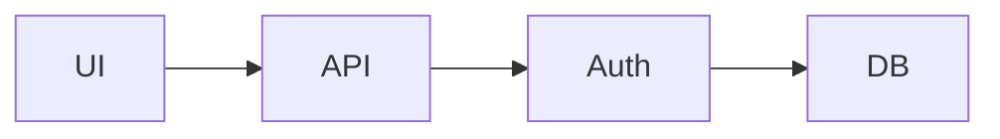

# ByteBoy Markdown 编辑器初步需求

> 状态：初步需求 / 架构方向  
> 适用项目：Dozer、Digger  
> 核心原则：共享 Markdown Core，分别构建工程型编辑器与写作型编辑器

## 1. 背景

ByteBoy 体系需要两类 Markdown 编辑能力：

1. **Dozer Markdown Editor**：面向需求、技术设计、代码、图形和 Agent 协作的基础工程文档编辑器。
2. **Digger Writing Editor**：面向分章节长篇写作、图片与素材管理、持续创作和 AI 辅助写作的写作工作台。

两者都以 Markdown 为重要的开放文件格式，但使用场景、文档模型和交互方式明显不同，因此不应设计成同一个 Markdown Editor 的“基础版/高级版”。

总体原则：

- Dozer：**Markdown 是工程文件（Engineering Document）**
- Digger：**Markdown 是作品的持久化载体（Manuscript Storage）**
- 两者共享底层 Markdown 基础设施，但不强行共享上层 Editor UX。
- Markdown 应始终尽可能保持为 source of truth，避免被封闭的富文本 JSON Schema 锁定。
- 从第一版开始考虑 Agent-native Editing，而不是后期附加 AI Chat。

---

## 2. 总体架构

```text
                         Markdown Core
                              │
             ┌────────────────┴────────────────┐
             │                                 │
           Dozer                             Digger
             │                                 │
     Engineering Editor                 Writing Editor
             │                                 │
        Source-first                      Visual-first
             │                                 │
       File-oriented                   Manuscript-oriented
             │                                 │
      Code / Mermaid                   Image / Media
             │                                 │
      Agent Mutation                    AI Writing
```

建议共享能力进一步拆分为：

```text
markdown-core
├── AST
├── parser
├── serializer
├── source map
├── block identity
└── mutation primitives

markdown-engineering
├── code block
├── Mermaid
├── table
├── task
└── engineering extensions

markdown-writing
├── chapter / section
├── image asset
├── caption
├── footnote
├── citation
└── manuscript
```

依赖关系：

```text
Dozer  ──→ markdown-core + markdown-engineering

Digger ──→ markdown-core + markdown-writing
                    │
                    └── 可按需复用 engineering renderer
                        （如 Mermaid、代码块）
```

---

# 3. Markdown Core

Markdown Core 是 Dozer 与 Digger 共享的基础设施，也是整个设计中最需要保持稳定的部分。

## 3.1 基本职责

Markdown Core 至少应负责：

- Markdown Parser
- Markdown AST / Block Model
- Markdown Serializer
- Source Range / Source Map
- Block Identity
- Selection Model
- Mutation Primitives
- Render Model
- 文档增量更新能力

Markdown Core 不应包含：

- Dozer 特定 UI
- Digger 写作 UI
- Project/File Tree
- Book/Manuscript 管理
- Agent Chat UI
- 图片素材管理 UI

## 3.2 Markdown 兼容性

基础语法优先兼容：

- CommonMark
- GitHub Flavored Markdown（GFM）

至少支持：

- Heading
- Paragraph
- Bold / Italic / Strikethrough
- Ordered / Unordered List
- Task List
- Blockquote
- Link
- Image
- Table
- Horizontal Rule
- Inline Code
- Fenced Code Block
- Footnote（可作为扩展）

## 3.3 Source Map

Source Map 是核心能力，不应只为 Preview Sync Scroll 服务。

目标关系：

```text
Markdown Source
      ↕
    AST Block
      ↕
 Rendered Block
      ↕
    Viewport
```

应支持：

- Source Range → Block
- Block → Source Range
- Source Position → Render Position
- Render Position → Source Position
- Selection → Typed Selection
- Agent Mutation → UI 定位
- 修改后尽可能恢复原 Viewport / Selection

## 3.4 Block Identity

不能长期依赖 byte offset 作为文档块的唯一身份。

建议 Markdown Core 支持稳定或半稳定的 Block Identity，例如：

```text
Block
├── block_id
├── type
├── source_range
├── content_hash
├── heading_path
└── metadata
```

具体 Block ID 是否写入 Markdown 文件，应保持实现可替换。

可选择：

1. 内嵌 metadata/comment；
2. sidecar metadata；
3. 基于结构、内容与位置动态恢复。

Digger 对稳定 Block ID 的需求高于 Dozer。

## 3.5 Typed Selection

Selection 不应只是：

```text
start_offset
end_offset
text
```

而应尽可能转换为：

```text
TypedSelection
├── block_type
├── block_id
├── source_range
├── selected_range
├── heading_path
├── language
├── attributes
└── content
```

例如 Mermaid 选择：

```text
type: fenced_code
language: mermaid
heading_path:
  - Architecture
  - Cache Design
```

该能力将直接服务 Agent Context。

## 3.6 Mutation Engine

Markdown Core 应提供结构化修改原语，例如：

```text
replace_range(...)
replace_block(...)
insert_before(...)
insert_after(...)
delete_block(...)
move_block(...)
transform_block(...)
replace_section(...)
```

目标是尽可能避免 Agent 直接依赖不稳定的 byte offset。

---

# 4. Dozer Markdown Editor

## 4.1 产品定位

Dozer Markdown Editor 是：

> 面向需求、技术设计、代码、图形以及 Human + Agent 协作的轻量级工程 Markdown 编辑器。

它不是：

- Obsidian 替代品
- Word 替代品
- 长篇写作软件
- 重型 WYSIWYG 编辑器

Markdown 文件应与 `.rs`、`.toml`、`.json` 等文件一样成为 Dozer Project 中的一等文件。

## 4.2 核心使用场景

主要面向：

- README
- 产品需求
- 需求规格说明
- 技术设计
- 架构说明
- API 设计
- Agent 生成的技术文档
- TODO / Task
- 代码说明
- Mermaid 图
- 项目知识文档

典型文档：

```markdown
# User Authentication

## Requirements

- [ ] Support OAuth
- [ ] Support local login

## Architecture



## Interface

```rust
pub trait AuthProvider {
    fn login(&self) -> Result<User>;
}
```
```

## 4.3 编辑模式

Dozer 应坚持 **Source-first**。

V1 建议只提供三种主要状态：

```text
Edit             Split             Preview
────             ─────             ───────
Markdown         MD | Render       Render
```

默认模式建议：

**Edit**

不建议 V1 优先开发完整 WYSIWYG / Visual Editor。

## 4.4 V1 必备能力

### Markdown

- CommonMark/GFM
- Heading
- List
- Task List
- Table
- Quote
- Link
- Image
- Code Block

### Code

- fenced code block
- language detection
- syntax highlighting
- Copy Code
- 与 Dozer Code Editor / LSP 的进一步联动预留接口

### Mermaid

Mermaid 是 Dozer Markdown 的核心扩展，应给予较高优先级。

支持：

- Mermaid fenced block
- 即时 Preview
- 错误提示
- Source ↔ Render 定位
- Agent 精确选择 Mermaid Block

未来可扩展：

- 点击图形定位源代码
- 图形选择 → Agent Context
- Agent 修改 Mermaid → 即时刷新

### Table

V1：

- GFM Table Render
- Source Editing

后续：

- Table Visual Editing
- 行列插入/删除
- 对齐
- CSV/TSV 粘贴

### Image

Dozer 图片能力保持简单：

- Paste Image
- Drag & Drop Image
- 自动保存至项目 assets
- 自动生成相对 Markdown 路径
- Preview
- Open / Reveal File

不在 Dozer 中优先建设复杂 Asset Manager。

### Navigation

支持：

- Heading Outline
- Heading Jump
- Link Navigation
- Project-relative File Link
- Source ↔ Preview Sync
- Cmd/Ctrl + Click

## 4.5 Agent-native Editing

Dozer Markdown Editor 的主要差异化不应是 WYSIWYG，而应是 Agent Editing。

整体关系：

```text
Human
 │
 ├── Current File
 ├── Viewport
 ├── Selection
 └── Current Block
          │
          ↓
        Agent
          │
     Mutation Engine
      ↙    ↓    ↘
   Range  Block  File
          │
          ↓
   Change Feedback
```

Agent Context 至少应能获得：

- 当前文件
- 当前 Viewport
- 当前 Selection
- Typed Selection
- 当前 Heading Path
- 当前 Block
- 相关项目文件
- 相关代码

典型操作：

> “把这个 Mermaid 图增加 Redis Cache。”

Agent 应获得 Mermaid block，而不是只有一段普通字符串。

## 4.6 Change Feedback

Agent 修改完成后：

- Editor 立即刷新
- 定位修改区域
- 保持合理 Viewport
- 高亮变化
- 可查看 Diff
- 支持 Undo

Dozer 更适合展示 **Source Diff**。

---

# 5. Digger Writing Editor

## 5.1 产品定位

Digger Writing Editor 是：

> 面向长篇、分章节、多素材内容创作的 AI-native Writing Workspace。

它不是 Dozer Markdown Editor 的高级模式。

Digger 的核心对象不是 File，而是：

**Writing Project / Manuscript / Book**

## 5.2 文档模型

建议项目组织形式：

```text
MyBook/
├── book.yaml
├── chapters/
│   ├── 01-introduction.md
│   ├── 02-history.md
│   ├── 03-ai.md
│   └── ...
├── assets/
│   ├── images/
│   ├── diagrams/
│   └── references/
├── .digger/
│   └── index.db
└── output/
```

作者主要看到的应该是：

```text
Writing Project
│
├── Metadata
├── Outline
├── Chapter 01
│   ├── Section
│   └── Section
├── Chapter 02
├── Assets
├── References
└── Export
```

而不是操作系统式 File Tree。

## 5.3 Visual-first Editing

Digger 建议采用：

> Visual-first + Markdown-backed

作者正常看到：

```text
AI 的发展

人工智能的发展经历了漫长的历史……
```

而不是长期看到：

```markdown
# AI 的发展

人工智能的发展经历了漫长的历史……
```

但 Markdown 仍尽可能保持 source of truth。

## 5.4 Progressive Syntax Reveal

可以采用渐进语法显示：

```text
AI 的发展

      ↓ cursor enters

# AI 的发展
```

这样同时获得：

- 接近富文本的写作体验
- Markdown 可控性
- Source 可编辑性
- Git 友好
- Agent 友好
- 避免封闭 JSON Document Schema

Digger 仍应保留 Markdown Source Mode，供高级用户和诊断使用。

## 5.5 长篇文档

必须重点解决：

- 数万至十万字以上作品
- 多章节
- Section / Subsection
- Outline Navigation
- Chapter Reorder
- Cross Chapter Search
- 全书术语一致性
- 全书 Agent Context
- Chapter Summary
- Incremental Rendering

避免把整本书长期维护成一个超大 `.md` 文件。

## 5.6 图片与 Asset

Digger 中图片不是简单的：

```markdown

```

而应被视为 Asset。

建议模型：

```text
Image Asset
├── original
├── optimized
├── thumbnail
├── caption
├── alt
├── credit/source
├── copyright
├── prompt
└── generation history
```

支持：

- Upload
- Paste
- Drag & Drop
- Image Library
- Replace
- Crop
- Caption
- Alt Text
- Credit / Source
- AI Generate
- AI Edit
- Re-generate
- Version History

最终 Markdown 仍保存稳定引用。

## 5.7 Agent Writing Context

Digger Agent Context 应从 File Context 提升为 Book Context：

```text
Book
├── Thesis
├── Audience
├── Style
├── Outline
├── Previous Chapters
├── Current Chapter
├── Terminology
├── Characters / Entities
├── References
└── Assets
```

Agent 操作粒度包括：

```text
Paragraph
   ↓
Block
   ↓
Section
   ↓
Chapter
   ↓
Book
```

典型任务：

- 改写段落
- 扩写
- 缩写
- 调整语气
- 重组 Section
- 重组 Chapter
- 检查章节重复
- 检查术语一致性
- 根据全书上下文续写
- 根据资料生成章节
- 插入/生成图片
- 生成 Caption / Alt
- 检查引用

## 5.8 Book Memory

Digger 应具有持久化的作品级 Context：

- Writing Style
- Audience
- Thesis
- Terminology
- Character / Entity Bible
- Reference Library
- Outline
- Chapter Summary
- Decisions / Constraints

这些内容不应每次依赖模型重新从整本书推断。

## 5.9 Stable Block Identity

长篇写作特别需要稳定 Block Identity。

例如 sidecar：

```text
.digger/
└── index.db
```

保存：

```text
block_id
file
range
hash
semantic_id
asset_refs
agent_history
```

目标：

> 即使作者在前面增加数千字，系统仍能识别昨天 Agent 修改的是哪个段落。

## 5.10 Diff

Digger 不应主要向作者展示 Git/source diff。

应提供 **Prose Diff**：

- 删除文字
- 新增文字
- 段落移动
- Section 移动
- 图片替换
- Caption 修改

底层仍可保留 Git Diff。

---

# 6. Dozer 与 Digger 的边界

| 维度 | Dozer | Digger |
|---|---|---|
| 核心对象 | File | Manuscript / Book |
| 文档性质 | Engineering Document | Writing Work |
| 默认编辑 | Markdown Source | Visual Markdown |
| Source Mode | 第一等 | 高级/辅助 |
| Preview | Split / Preview | Inline |
| 文档长度 | 短/中 | 长/超长 |
| 导航 | File + Heading | Book → Chapter → Section |
| Code | 强 | 基础 |
| Mermaid | 强 | 可用 |
| Table | 强 | 中等 |
| 图片 | 基础 | 核心 |
| Asset Manager | 简单 | 核心 |
| Citation | 基础 | 强 |
| Footnote | 基础 | 强 |
| Agent 单位 | Selection / Block / File | Paragraph / Section / Chapter / Book |
| Agent 任务 | 修改/实现/同步 | 写/改/扩/缩/重组 |
| Git | 强可见 | 尽量隐藏 |
| Diff | Source Diff | Prose Diff |
| Export | `.md` | Markdown / DOCX / PDF / EPUB / Web |

---

# 7. UI / UX 参考方向

初步调研中值得重点研究的项目：

## Velotype

重点研究：

- Block-based Markdown
- Markdown Source of Truth
- Visual / Source Editing 的关系
- Block Model

适合作为 **底层架构参考**。

## Markion

重点研究：

- Visual Edit
- Progressive Syntax Reveal
- Source-backed Mutation
- Slash Command
- Block Context Menu
- Selection Toolbar
- Drag Reorder
- Source-mapped Sync Scroll

适合作为 **Digger 编辑交互和 Agent Mutation 的重要参考**。

## Aster

重点研究：

- Rust + GPUI
- Rope
- Markdown Span Parsing
- Inline Editing
- 小型 Editor 架构

适合作为 **Dozer 初始实现的代码研究对象**。

## Gmark

重点研究：

- Source / Live / Split / Preview
- Mermaid
- Math
- Table
- Code Block
- Outline
- Find / Replace
- Selection Toolbar
- Command Palette

适合作为 **Dozer 功能 Checklist**。

## Ferrite

重点研究：

- WYSIWYG
- Split View
- Code Folding
- Table Editing
- Mermaid
- Structured Data

主要作为 **功能设计参考**，不必绑定其 UI 技术栈。

## MarkEdit

重点研究：

- 极简 Markdown UX
- 低干扰写作
- macOS 原生感
- 编辑器视觉克制

适合作为 **Dozer 编辑体验“减法设计”参考**。

---

# 8. 技术路线建议

如果 Dozer 继续向 GPUI / Zed Editor 技术体系发展，建议优先研究：

```text
             Dozer
               │
      ┌────────┴────────┐
      │                 │
Text/Edit Engine    Markdown Engine
      │                 │
     Rope           Markdown AST
      │                 │
      └────────┬────────┘
               │
         Document Model
               │
       ┌───────┼────────┐
       │       │        │
     Source   Split   Preview
       │       │        │
       └───────┼────────┘
               │
             GPUI
```

Digger 在 Markdown Core 成熟后进一步构建：

```text
Markdown Core
      │
Writing Document Model
      │
Block / Visual Editor
      │
Manuscript Model
      │
Asset Manager
      │
Book Context / Memory
      │
AI Writing Agent
```

---

# 9. 开发阶段建议

## Phase 1：Markdown Core

目标：建立可长期共享的 Markdown 基础设施。

优先实现：

- Parser
- AST
- Source Map
- Block Model
- Serializer
- Mutation Primitives
- Incremental Update 基础
- Typed Selection 基础

## Phase 2：Dozer Markdown V1

目标：形成真正可用于日常工程工作的 Markdown Editor。

实现：

- Source Editor
- Syntax Highlight
- Preview
- Split View
- GFM
- Code Block
- Mermaid
- Table
- Image
- Outline
- Source ↔ Preview Mapping
- Agent Typed Selection
- Agent Mutation
- Change Feedback

明确暂缓：

- 完整 WYSIWYG
- 重型 Asset Manager
- 长篇 Manuscript
- Publishing Workflow

## Phase 3：验证 Agent-native Editor

使用 Dozer Markdown 作为 Agent-native Editor 的第一个完整验证对象。

验证：

```text
Viewer
+
Shared Viewport
+
Typed Selection
+
Context Scope
+
Mutation Engine
+
Change Feedback
```

重点确认：

- Human 与 Agent 是否能共享准确上下文
- Block Mutation 是否可靠
- Agent 修改后是否能稳定定位
- Source Map 是否足够支撑 UI 与 Agent

## Phase 4：Digger Writing Editor

基于已经稳定的 Markdown Core 开发：

- Visual Markdown
- Progressive Syntax Reveal
- Manuscript
- Chapter / Section
- Stable Block ID
- Asset Manager
- Image Workflow
- Book Context
- Book Memory
- AI Writing
- Prose Diff
- Export

---

# 10. 初步设计原则

1. **Markdown 保持开放。** 用户永远可以拿走 `.md` 文件。
2. **Markdown 尽可能作为 Source of Truth。**
3. **Dozer Source-first，Digger Visual-first。**
4. **共享 Core，不强行共享 Editor UX。**
5. **Dozer 面向 File，Digger 面向 Manuscript。**
6. **Dozer 优先代码和图形，Digger 优先文字和图片。**
7. **Source Map 是基础设施，不只是 Preview 功能。**
8. **Selection 必须逐渐从 Text Range 升级为 Typed Selection。**
9. **Agent 修改应优先使用结构化 Mutation，而不是裸字符串替换。**
10. **Stable Block Identity 是长期 Agent 协作的重要基础。**
11. **Human 与 Agent 必须共享 Viewport、Selection 和 Document Structure。**
12. **修改后必须立即反馈并能定位到变化位置。**
13. **Dozer 不追求成为 Obsidian；Digger 不追求成为 Word。**
14. **两者最终都服务于 Project，而不是孤立的 Editor。**

---

# 11. 当前结论

ByteBoy 不应建设一个“大而全”的通用 Markdown Editor，再分别嵌入 Dozer 和 Digger。

更合理的方向是：

```text
                 Markdown Core
                      │
          ┌───────────┴───────────┐
          │                       │
        Dozer                   Digger
          │                       │
  Engineering Markdown      Writing Markdown
          │                       │
  构造东西的文档              写出东西的作品
```

Dozer Markdown Editor 应首先成为 **Agent-native Engineering Editor**：

> 简洁、精确、Source-first，对代码、Mermaid、需求文档和 Agent Mutation 友好。

Digger 则在相同 Core 之上发展为 **AI-native Writing Workspace**：

> Visual-first、长篇、分章节、图片/素材密集，并拥有作品级 Context 与 Agent Writing 能力。

因此，近期最合理的开发顺序是：

**Markdown Core → Dozer Markdown V1 → 验证 Agent-native Editing → Digger Writing Editor。**

这既可以避免重复开发，又不会因为过度追求 UI 共用而限制两个产品未来的形态。
